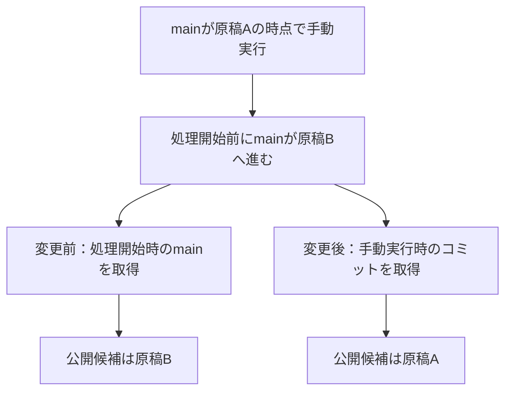
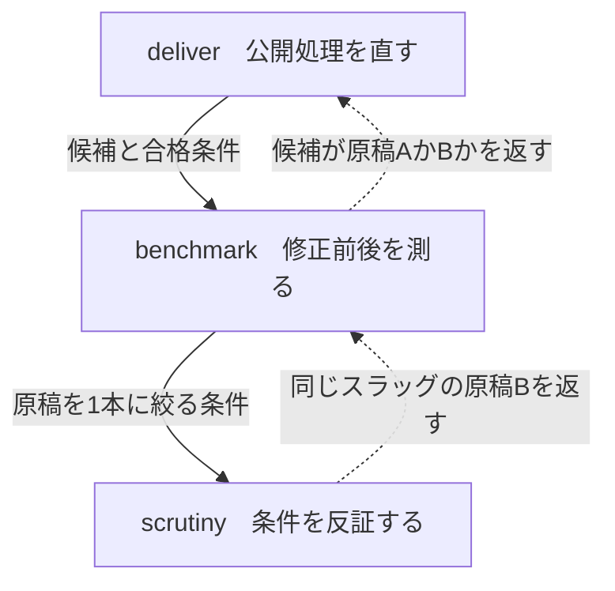

Zennへの公開を指示したあと、処理が始まる前に同じ記事の修正版が `main` に入ると、どちらが公開候補になるでしょうか。自分の記事リポジトリでは、公開対象を1本に絞るチェックを通っても、手動実行のあとに入った原稿が候補になることが分かりました。

AIにこの修正を任せるなら、「対象は1本」と伝えたあとに「原稿の中身も照合して」「修正前の手順でも同じ条件で試して」と指示を足したくなります。Kafstylerは、開発・調査・制作・運用でこうした追加指示を減らすために作った、Claude CodeとCodex向けのプラグインです。エージェントが必要なスキルに対象や合格条件を渡し、返ってきた結果を使って作業を進める手順を定めています。今回はその手順で原稿の取り違えを再現し、修正前後を比べました。 [スキル間の連携](https://github.com/KAFKA2306/kafstyler/blob/f0e05572899150dc8b0fdcd1a1ceab5d951d7bb8/AGENTS.md#コマンドの連携)

公開処理の修正にはKafstyler 0.5.6を使い、この記事のスキルとフックの説明は0.5.9で照合しました。 [0.5.6のコミット](https://github.com/KAFKA2306/kafstyler/commit/43178a5d62b405e7d469f5dc7f46e596a001f456) · [0.5.9のコミット](https://github.com/KAFKA2306/kafstyler/commit/f0e05572899150dc8b0fdcd1a1ceab5d951d7bb8)

## 公開候補を手動実行時点の原稿に固定する

公開担当者が記事のスラッグ（URLで記事を識別する名前）を指定して手動実行すると、GitHub Actionsが公開候補を用意し、差分があれば公開用のプルリクエスト（PR）を作ります。担当者がPRをマージすると、Zennに接続した `zenn-release` ブランチが更新されます。 [変更前の公開ワークフロー](https://github.com/KAFKA2306/articles/blob/2e48911f900cceecbb8897b57f5f95fef242dd93/.github/workflows/zenn-manual-release.yml)

手動実行時の原稿をA、処理が始まる前に `main` に入った修正版をBとします。AとBのスラッグが同じで、どちらも `published: true` なら、Bが候補になっても記事を1本に絞るチェックは通ります。



GitHub Actionsは、手動実行を受け付けた時点のコミットを `github.sha` で渡します。変更前は取得先に `main` を指定していたため、その後に入った原稿を取得する場合がありました。取得先を `github.sha` に変え、公開用PRの本文に `source` としてそのコミットを記録するようにしました。 [GitHubの手動実行仕様](https://docs.github.com/en/actions/reference/workflows-and-actions/events-that-trigger-workflows#workflow_dispatch) · [修正後のチェックアウト](https://github.com/KAFKA2306/articles/blob/0ea888ed8f43b526e1fd59ccaf9c5a829c702db8/.github/workflows/zenn-manual-release.yml#L37-L43)

隔離したローカルのGitリポジトリで、ワークフロー定義から取り出したBashを実行しました。Aのコミットを記録し、原稿を取得する前に `main` をBまで進めると、変更前はB、変更後はAが公開用の作業ブランチに入りました。差分はいずれも同じ記事のMarkdownファイル1件です。比較用に `published: false` の別記事を指定すると、公開候補を作る前に拒否されました。 [修正PRと実験記録](https://github.com/KAFKA2306/articles/pull/228)

実験ではGitHub上のPR作成を代替処理に置き換え、ローカルGitで公開候補ができるところまで確認しました。手動実行時点の版を固定しても、担当者が原稿を読んでから実行するまでに `main` が進むことはあります。

マージする前に、公開用PRの本文にある `source` を開き、そこで読めるMarkdownと「Files changed」にある公開原稿を照合します。両方のコミットをローカルに取得していれば、`git diff <sourceのSHA> <公開用PRの先端SHA> -- articles/<slug>.md` でも比較できます。 [PR本文を生成する処理](https://github.com/KAFKA2306/articles/blob/0ea888ed8f43b526e1fd59ccaf9c5a829c702db8/.github/workflows/zenn-manual-release.yml#L163-L181)

## 反例を見つけるスキルと修正前後を比べるスキル

最初に `charter` で、「対象の記事は1本」という既存の条件に「手動実行時点の原稿と公開候補の中身が一致する」を加えました。`scrutiny` でスラッグが同じでも中身が違う例を見つけ、`benchmark` では同じAとBを使って修正前後を比較しました。`deliver` で公開処理を修正し、この記事は `humanizer` で、本文と図が同じ内容を示し、読者が出典までたどれるかを確かめました。

評価から始めることもできます。`benchmark` の途中で判定方法の弱点を調べたいときは、対象とその版、入力、期待する結果、作業範囲を `scrutiny` に渡します。判定をすり抜ける例が見つかれば、その例と見分け方を進行中の評価に返します。同じ評価の中で比較を続けられます。 [スキル間の連携](https://github.com/KAFKA2306/kafstyler/blob/f0e05572899150dc8b0fdcd1a1ceab5d951d7bb8/AGENTS.md#コマンドの連携)



| スキル | 呼ぶ場面 | 返すもの |
| --- | --- | --- |
| [`charter`](https://github.com/KAFKA2306/kafstyler/blob/f0e05572899150dc8b0fdcd1a1ceab5d951d7bb8/skills/charter/SKILL.md) | 「安全に公開したい」と頼まれ、何が起きれば完了か決まっていない | 担当者が普段使う操作と、手動実行時点の原稿が候補に入るという合格条件 |
| [`scrutiny`](https://github.com/KAFKA2306/kafstyler/blob/f0e05572899150dc8b0fdcd1a1ceab5d951d7bb8/skills/scrutiny/SKILL.md) | 本数だけでは、候補に入った原稿を見分けられない | 同じスラッグで中身を変えた例と、原稿を見分ける条件 |
| [`benchmark`](https://github.com/KAFKA2306/kafstyler/blob/f0e05572899150dc8b0fdcd1a1ceab5d951d7bb8/skills/benchmark/SKILL.md) | 修正の前後で、どちらの原稿が候補に入るか比べたい | 同じAとBを使った比較結果と、再確認に使える記録 |
| [`deliver`](https://github.com/KAFKA2306/kafstyler/blob/f0e05572899150dc8b0fdcd1a1ceab5d951d7bb8/skills/deliver/SKILL.md) | 原因は分かったが、公開処理の修正が残っている | コミットを固定する変更と、候補を作って確かめた結果 |
| [`humanizer`](https://github.com/KAFKA2306/kafstyler/blob/f0e05572899150dc8b0fdcd1a1ceab5d951d7bb8/skills/humanizer/SKILL.md) | 公開担当者が、どこで何の版を確認するか読み取れない | 操作手順と根拠、どこまで確かめたかが分かる文書 |
| [`schema`](https://github.com/KAFKA2306/kafstyler/blob/f0e05572899150dc8b0fdcd1a1ceab5d951d7bb8/skills/schema/SKILL.md) | 承認記録を作るとき、記事と承認した版をどう結び付けるか決まっていない | スラッグとコミットなどで承認1件を識別し、どの記録を参照の基準にするかの取り決め |
| [`prune`](https://github.com/KAFKA2306/kafstyler/blob/f0e05572899150dc8b0fdcd1a1ceab5d951d7bb8/skills/prune/SKILL.md) | 移行後も旧手順が残り、どちらを使うか迷う | 旧手順の削除と、残したリンクから現行手順をたどって操作できることの確認 |

`schema` と `prune` の行は、承認記録を新設したり旧手順を整理したりする場合の例です。調査・実装・整理のどこから始めた仕事でも、表のような判断が必要になれば該当するスキルを呼べます。

共通の作業規約は `AGENTS.md`、目的と更新手順は `MISSION.md`、判断に使う資料は `BIBLES.md` に置いています。別の案件でも同じ不足が再現したときは、その案件を直したうえでKafstylerの共通手順も見直せます。 [目的と更新手順](https://github.com/KAFKA2306/kafstyler/blob/f0e05572899150dc8b0fdcd1a1ceab5d951d7bb8/MISSION.md) · [資料の見直し](https://github.com/KAFKA2306/kafstyler/blob/f0e05572899150dc8b0fdcd1a1ceab5d951d7bb8/BIBLES.md#資料の見直し)

## Claude CodeとCodexのフックと導入手順

Claude CodeとCodexはどちらも、セッション開始や依頼の送信といったイベントに応じて、フックで `hooks/quality.sh` を実行します。プラグインのルートを渡す変数と、`Stop` で返す形式はホストごとに異なります。 [Claude Codeのマニフェスト](https://github.com/KAFKA2306/kafstyler/blob/f0e05572899150dc8b0fdcd1a1ceab5d951d7bb8/.claude-plugin/plugin.json) · [Codexのマニフェスト](https://github.com/KAFKA2306/kafstyler/blob/f0e05572899150dc8b0fdcd1a1ceab5d951d7bb8/.codex-plugin/plugin.json) · [フックの実装](https://github.com/KAFKA2306/kafstyler/blob/f0e05572899150dc8b0fdcd1a1ceab5d951d7bb8/hooks/quality.sh)

| イベント | フックが渡す指示 |
| --- | --- |
| `SessionStart` | プラグイン同梱の `AGENTS.md` を含む作業規約 |
| `SubagentStart` | 委譲先に伝える作業規約と、依頼元の合格条件を使う指示 |
| `UserPromptSubmit` | 作業前に `charter`、提出前に `benchmark`、人が読む文書には `humanizer` を使う指示 |
| `Stop` | 提出前に成果物を合格条件と照らし合わせる指示 |

### 導入と呼び出し

以下の導入コマンドを使うには、Claude Codeは2.1.292以降が必要です。 [Kafstylerの導入手順](https://github.com/KAFKA2306/kafstyler/blob/f0e05572899150dc8b0fdcd1a1ceab5d951d7bb8/README.md#プラグインの使い方) · [Claude Codeの導入コマンドの要件](https://code.claude.com/docs/en/discover-plugins#add-and-install-from-your-shell)

```sh
# Claude Code
claude plugin install kafstyler --marketplace KAFKA2306/agent-resources --scope user

# Codex
codex plugin marketplace add KAFKA2306/kafstyler
codex plugin add kafstyler@kafstyler
```

導入後は対象のプロジェクトでClaude CodeかCodexを起動し、普段どおり依頼できます。Codexでフックを動かすには、`/hooks` でKafstylerのフックを確認して承認します。承認前でも `$` からスキルを選べます。Claude Codeでスキルを直接呼ぶには `/kafstyler:charter` のように指定します。 [Codexの導入手順](https://github.com/KAFKA2306/kafstyler/blob/f0e05572899150dc8b0fdcd1a1ceab5d951d7bb8/README.md#codex) · [Codexのフック承認](https://learn.chatgpt.com/docs/hooks#review-and-trust-hooks)

`Stop` はそのターンの提出前に見直しを1回促すフックです。Claude Codeで同じ依頼を定期的に実行するときは、セッション内で `/loop` を使います。Kafstylerの `deliver` は、各回で前回の結果を引き継ぎ、完了・中止・人の操作待ちになったら対象ジョブを `CronDelete` で解除して `CronList` で確かめる手順を定めています。 [Kafstylerの連携手順](https://github.com/KAFKA2306/kafstyler/blob/f0e05572899150dc8b0fdcd1a1ceab5d951d7bb8/skills/deliver/SKILL.md) · [Claude Codeの定期実行](https://code.claude.com/docs/en/scheduled-tasks)

Claude CodeでREADMEの起動手順を検証する例です。この例では5分間隔を指定しています。

```text
/loop 5m /kafstyler:deliver READMEの起動手順を空の作業ディレクトリから試し、サンプルにアクセスできるまで直す
```

## Stopの出力を手元で確かめる

両方のマニフェストが呼び出すシェルをBashで直接実行し、その出力をホストの公式仕様と照合しました。次のコマンドは、0.5.9のコミットをチェックアウトしたKafstylerのルートで実行できます。 [Claude CodeのStop](https://code.claude.com/docs/en/hooks#stop-decision-control) · [CodexのStop](https://learn.chatgpt.com/docs/hooks#stop)

```sh
for active in false true; do
  printf '{"stop_hook_active":%s}\n' "$active" |
    CLAUDE_PLUGIN_ROOT="$PWD" bash hooks/quality.sh review
  printf '{"stop_hook_active":%s}\n' "$active" |
    PLUGIN_ROOT="$PWD" bash hooks/quality.sh review codex
done
```

| 入力 | Claude Code向けの標準出力 | Codex向けの標準出力 |
| --- | --- | --- |
| `stop_hook_active: false` | `hookSpecificOutput.additionalContext` に提出前の確認指示 | `decision: "block"` と `reason` |
| `stop_hook_active: true` | `{}` | `{}` |

両ホスト向けに2種類ずつ、計4通りの入力を試しました。まだ `Stop` で続行していないことを示す入力では確認指示を返し、続行後を示す入力ではどちらも `{}` を返しました。実験の範囲はシェルの応答までです。モデルがフックの指示を受けて原稿やコードを修正するところは、両ホスト上で未確認です。 [テスト対象のシェル](https://github.com/KAFKA2306/kafstyler/blob/f0e05572899150dc8b0fdcd1a1ceab5d951d7bb8/hooks/quality.sh)

## 同じ見出しと出典でも誤った手順は通る

見出しと出典URLが合っていても、手順を間違えている原稿を見分けられるでしょうか。正しい原稿と、導入やフックの説明に誤りを一つずつ加えた原稿を用意しました。この節を判定対象から外し、3稿の見出しと出典URLをそろえて比較しました。 [比較の記録](https://github.com/KAFKA2306/articles/pull/227)

| 原稿 | 見出しと出典URLを照合 | 読者の操作と実装を照合 |
| --- | --- | --- |
| 正しい記述を残した原稿 | 合格 | 合格 |
| Codexの `/hooks` 承認手順を削除 | 合格 | 不合格。導入後にフックを承認する操作が抜けている |
| `Stop` が定期実行を登録すると記述 | 合格 | 不合格。シェルの出力と `/loop` の仕様に反する |

用意した誤り2件は、見出しと出典URLの照合ではどちらも通りました。読者の操作を公式仕様とシェルの出力に照らし合わせると、正しい原稿を通したうえで2件とも検出できました。どちらの資料も、原稿をどう書いたかを知らずに確認できます。 [Codexのフック承認](https://learn.chatgpt.com/docs/hooks#review-and-trust-hooks) · [Claude Codeの定期実行](https://code.claude.com/docs/en/scheduled-tasks)

1. KafstylerをCodexに導入したあと、フックを動かすために読者は何をするか。原稿のどこに書いてあるか。
2. そのターンの最初の `Stop` で何が返るか。定期実行を登録する操作を原稿で見分けられるか。説明はシェルの出力と合っているか。

`benchmark` は、正しい例が通り、誤った例が落ちるかを確かめるよう定めています。今回はそれを記事の評価に適用し、読者の操作を確認項目に加えました。Kafstylerの共通手順そのものに不足が見つかった場合は、使った版と再現入力を残し、元の案件と別分野の案件で修正前後を比べます。記事に固有の不足は記事側で直します。 [評価手順](https://github.com/KAFKA2306/kafstyler/blob/f0e05572899150dc8b0fdcd1a1ceab5d951d7bb8/skills/benchmark/SKILL.md) · [本体の更新手順](https://github.com/KAFKA2306/kafstyler/blob/f0e05572899150dc8b0fdcd1a1ceab5d951d7bb8/MISSION.md#更新手順)

## 自分の仕事で試す

AIに任せたあとで「次はこれ」と付け足した仕事を一つ選び、何を見てその指示を出し、結果がどう変わったかを書き出します。

たとえば候補に入った原稿の版を確かめるなら、次のように依頼できます。

> 手動実行時点の原稿と公開候補の中身が一致すれば合格です。スラッグが同じで中身の異なる原稿を2つ用意し、後から入った原稿を候補にすると不合格になり、実行時点の原稿なら合格するかを試してください。公開用PRの差分と元のコミットを示してください。

同じ確認は、成果物の版をGitのコミットなどで指定できる仕事に使えます。外部サービスで内容が後から変わる場合は、生成時の入力や配布されたファイルも照合します。判断に必要な資料が足りなければ、その資料を示して調査を依頼します。合格しても用事が済まない例が見つかったら、その例を使って合格条件を見直します。

実際の公開のように人の判断が必要な操作では、照合した候補と確認箇所を担当者に渡します。

この記事の調査・執筆・実験にはAIエージェントを使用しました。
