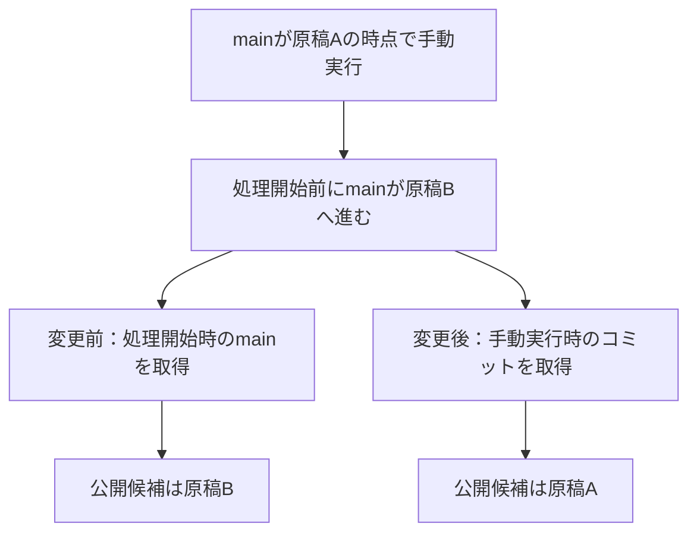
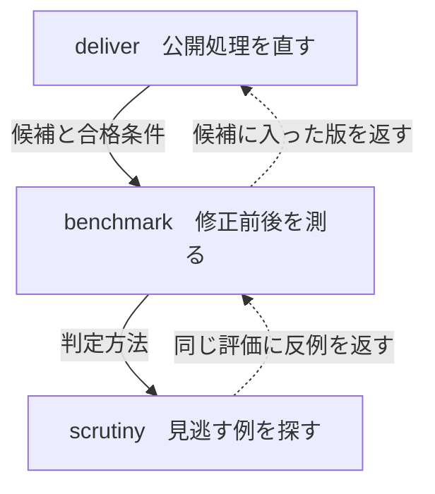

Zennへの公開を指示してから処理が始まるまでに、同じ記事の修正版が `main` に入ったら、どちらが公開候補になるでしょうか。自分の記事リポジトリの公開処理を調べると、手動実行の指示で選んだ版と、処理が始まったときの最新版が食い違う経路がありました。

Kafstylerを作ったのは、開発・調査・制作・運用のどこからでも、AIに仕事を任せたあと、人が「次は前提を確かめて」「今度はその条件で測って」と指示し続ける手間を減らすためです。作業中のスキルが、必要な判断を別のスキルに渡し、返ってきた結果で元の作業を進めます。今回はKafstylerのスキル定義に沿って、実際の公開処理の合格条件を決め、反例を確かめ、修正しました。 [スキル間の連携](https://github.com/KAFKA2306/kafstyler/blob/43178a5d62b405e7d469f5dc7f46e596a001f456/AGENTS.md#コマンドの連携)

スキルとフックの説明には、2026年11月17日のKafstyler 0.5.6を使います。 [対象コミット](https://github.com/KAFKA2306/kafstyler/commit/43178a5d62b405e7d469f5dc7f46e596a001f456)

## 1. 公開候補の版が変わる条件を確かめる

公開の仕組みには二つの操作があります。最初に人が記事のスラッグを指定して実行し、GitHub Actionsが公開用PRを作ります。そのPRを人がマージすると、Zennに接続した `zenn-release` ブランチが変わります。今回確かめたのは、手動実行を受け付けた時点の原稿が、公開用PRに入るかです。 [変更前の公開ワークフロー](https://github.com/KAFKA2306/articles/blob/2e48911f900cceecbb8897b57f5f95fef242dd93/.github/workflows/zenn-manual-release.yml)

たとえば手動実行を押した時点の原稿をA、そのあと `main` に入った原稿をBとします。AとBは同じスラッグで、どちらも `published: true` です。記事を1本に絞るチェックを通っても、中身がBに変わることはあります。



GitHub Actionsには、手動実行を受け付けたブランチのコミットが `github.sha` として渡ります。変更前はチェックアウト先に `main` と書いていたため、取得する対象は動くブランチ名でした。チェックアウトを `github.sha` に固定し、公開用PRにも取り出したコミットを書きます。 [GitHubの手動実行仕様](https://docs.github.com/en/actions/reference/workflows-and-actions/events-that-trigger-workflows#workflow_dispatch) · [変更前の公開ワークフロー](https://github.com/KAFKA2306/articles/blob/2e48911f900cceecbb8897b57f5f95fef242dd93/.github/workflows/zenn-manual-release.yml)

ローカルに隔離したGitリポジトリで、ワークフロー定義から取り出したBashを実行しました。手動実行に対応するコミットをAとして記録し、チェックアウト前に `main` をBへ進めます。変更前はB、変更後はAが公開用の作業ブランチに入りました。どちらの差分も、同じ記事のMarkdown 1件です。比較用に `published: false` の別記事も指定すると、公開準備の前に拒否されました。

今回の実験ではGitHub上のPR作成を代替処理に置き換え、Gitで候補を作るところまでを確認しました。人が原稿を読んだ時点と手動実行の間に `main` が進んだ場合は、手動実行時点の版が候補になります。公開担当者は、最後に公開用PRの差分とコミットを確認します。

## 2. 仕事の途中で、別のスキルに判断を渡す

今回の作業では `charter` で、公開対象を1本に絞る既存の条件に「手動実行時点と候補の原稿が同じ」を加えました。`scrutiny` が同じスラッグの別バージョンを反例として返し、`benchmark` がAとBを区別できる同じ条件で修正前後を比較します。結果を受けた `deliver` が修正し、この文章では `humanizer` の手順で読者が図と根拠を行き来できるかを確かめました。 [実装と検証](https://github.com/KAFKA2306/kafstyler/blob/43178a5d62b405e7d469f5dc7f46e596a001f456/skills/deliver/SKILL.md) · [目標設定](https://github.com/KAFKA2306/kafstyler/blob/43178a5d62b405e7d469f5dc7f46e596a001f456/skills/charter/SKILL.md) · [反証](https://github.com/KAFKA2306/kafstyler/blob/43178a5d62b405e7d469f5dc7f46e596a001f456/skills/scrutiny/SKILL.md) · [評価](https://github.com/KAFKA2306/kafstyler/blob/43178a5d62b405e7d469f5dc7f46e596a001f456/skills/benchmark/SKILL.md) · [文章の推敲](https://github.com/KAFKA2306/kafstyler/blob/43178a5d62b405e7d469f5dc7f46e596a001f456/skills/humanizer/SKILL.md)

逆に評価から始めても、`benchmark` は判定方法を `scrutiny` に渡せます。`scrutiny` が測れる反例を見つけたとき、`benchmark` がすでに進行中なら、新しく呼び直さずその評価に反例と判別条件を戻します。渡すのは対象と版、入力、期待する結果、作業範囲です。元の仕事が結果を受け取り、次に進めます。 [スキル間の連携](https://github.com/KAFKA2306/kafstyler/blob/43178a5d62b405e7d469f5dc7f46e596a001f456/AGENTS.md#コマンドの連携) · [評価の設計](https://github.com/KAFKA2306/kafstyler/blob/43178a5d62b405e7d469f5dc7f46e596a001f456/skills/benchmark/SKILL.md) · [反証を測る手順](https://github.com/KAFKA2306/kafstyler/blob/43178a5d62b405e7d469f5dc7f46e596a001f456/skills/scrutiny/SKILL.md)



| スキル | どんな場面で必要か | 仕事に返すもの |
| --- | --- | --- |
| [`charter`](https://github.com/KAFKA2306/kafstyler/blob/43178a5d62b405e7d469f5dc7f46e596a001f456/skills/charter/SKILL.md) | 「公開を安全に」と言われ、何が起きたら完了か決まっていない | 利用者が使う入口と、実行時点の原稿が候補に載るという合格条件 |
| [`scrutiny`](https://github.com/KAFKA2306/kafstyler/blob/43178a5d62b405e7d469f5dc7f46e596a001f456/skills/scrutiny/SKILL.md) | 1本だけなら安全に見えるが、本数だけでは原稿の版が分からない | 同じスラッグで中身を変えた反例と、区別するための条件 |
| [`benchmark`](https://github.com/KAFKA2306/kafstyler/blob/43178a5d62b405e7d469f5dc7f46e596a001f456/skills/benchmark/SKILL.md) | 修正後の一回だけ見ても改善か分からない | 同じA・Bを使った修正前後の判定と、再確認できる結果 |
| [`deliver`](https://github.com/KAFKA2306/kafstyler/blob/43178a5d62b405e7d469f5dc7f46e596a001f456/skills/deliver/SKILL.md) | 問題の説明はできても、実際の公開処理は変わっていない | コミットを固定する変更と、実物を確かめた結果 |
| [`humanizer`](https://github.com/KAFKA2306/kafstyler/blob/43178a5d62b405e7d469f5dc7f46e596a001f456/skills/humanizer/SKILL.md) | 公開担当者が、どこで何の版を確認するか読み取れない | 操作、根拠、確認できた範囲を読み手が追える文書 |
| [`schema`](https://github.com/KAFKA2306/kafstyler/blob/43178a5d62b405e7d469f5dc7f46e596a001f456/skills/schema/SKILL.md) | たとえば承認記録を新設するとき、記事と版の結び付け方が曖昧 | スラッグとコミットなど、何を一件として記録し、どれを正本とするかの取り決め |
| [`prune`](https://github.com/KAFKA2306/kafstyler/blob/43178a5d62b405e7d469f5dc7f46e596a001f456/skills/prune/SKILL.md) | たとえば移行後も旧公開手順が残り、どちらを使うか迷う | 旧手順を削り、参照先と通常の操作がつながった状態 |

今回の修正では承認記録の形式を変えていません。表の `schema` と `prune` は、別の変更が必要になったときに仕事を渡す場面です。入口が調査、実装、整理のどこでも、必要な判断が見つかった時点で呼び出せます。

`AGENTS.md` には共通の作業規約、`MISSION.md` には目的と更新手順、`BIBLES.md` には判断に使う資料を置きます。別の案件でも、同じ不足が再現できた場合は、案件側の修正に加えてKafstylerの共通手順を見直す候補にできます。 [ミッションと更新手順](https://github.com/KAFKA2306/kafstyler/blob/43178a5d62b405e7d469f5dc7f46e596a001f456/MISSION.md) · [資料の見直し](https://github.com/KAFKA2306/kafstyler/blob/43178a5d62b405e7d469f5dc7f46e596a001f456/BIBLES.md#資料の見直し)

## 3. Claude CodeとCodexで連携が始まるところ

Claude CodeとCodexのマニフェストは、同じ `hooks/quality.sh` を呼びます。違いが出るのは、ホストに応じたプラグインのルート指定と、最初の `Stop` に対する応答です。 [Claude Codeのマニフェスト](https://github.com/KAFKA2306/kafstyler/blob/43178a5d62b405e7d469f5dc7f46e596a001f456/.claude-plugin/plugin.json) · [Codexのマニフェスト](https://github.com/KAFKA2306/kafstyler/blob/43178a5d62b405e7d469f5dc7f46e596a001f456/.codex-plugin/plugin.json) · [フックの実装](https://github.com/KAFKA2306/kafstyler/blob/43178a5d62b405e7d469f5dc7f46e596a001f456/hooks/quality.sh)

| イベント | 同梱フックが返すもの |
| --- | --- |
| `SessionStart` | プラグイン同梱の `AGENTS.md` を含む作業規約 |
| `SubagentStart` | 作業規約に加え、親から受け取った合格条件で調べるよう委譲先に伝える追加コンテキスト |
| `UserPromptSubmit` | 作業前に `charter`、提出前に `benchmark`、人向け文書に `humanizer` を使う指示 |
| `Stop` | 初回は成果物を照合する指示。Claude Codeには追加コンテキスト、Codexには `decision: "block"` と続行理由を返す。フックで続行したあとの入力では `{}` を返す |

Codexの導入後、`/hooks` でKafstylerのフックを確認して承認します。承認前も、スキルは手動で選べます。 [Kafstylerの導入手順](https://github.com/KAFKA2306/kafstyler/blob/43178a5d62b405e7d469f5dc7f46e596a001f456/README.md#codex) · [Codexのフック承認](https://learn.chatgpt.com/docs/hooks#review-and-trust-hooks)

`Stop` は提出前の再確認を1回促します。定期実行を登録するのは、Claude Codeの `/loop` です。Claude Codeで `deliver` を使うとき、Kafstylerは `/loop` で同じ依頼を再実行し、各回で前回の結果を引き継ぐよう定めています。完了か中止、または人の操作を待つ状態になったら、対象ジョブを `CronDelete` で解除し、`CronList` で確認します。`/loop` の定期実行はセッションに属します。 [Kafstylerの連携手順](https://github.com/KAFKA2306/kafstyler/blob/43178a5d62b405e7d469f5dc7f46e596a001f456/skills/deliver/SKILL.md) · [Claude Codeの定期実行](https://code.claude.com/docs/en/scheduled-tasks) · [Claude CodeのStop](https://code.claude.com/docs/en/hooks#stop-decision-control) · [CodexのStop](https://learn.chatgpt.com/docs/hooks#stop)

### 導入と呼び出し

次はKafstylerのREADMEに掲載されている導入コマンドです。Claude Codeは2.1.292以降を使い、配布元は `KAFKA2306/agent-resources` です。Codexの配布元は `KAFKA2306/kafstyler` です。導入後は対象プロジェクトでホストを起動し、普段どおり依頼できます。スキルを直接指定するときは、Claude Codeで `/kafstyler:charter` のように呼び、Codexでは `$` で選びます。 [導入と更新の手順](https://github.com/KAFKA2306/kafstyler/blob/43178a5d62b405e7d469f5dc7f46e596a001f456/README.md#プラグインの使い方) · [Claude Codeの導入コマンドの要件](https://code.claude.com/docs/en/discover-plugins#add-and-install-from-your-shell)

```sh
# Claude Code
claude plugin install kafstyler --marketplace KAFKA2306/agent-resources --scope user

# Codex
codex plugin marketplace add KAFKA2306/kafstyler
codex plugin add kafstyler@kafstyler
```

Claude Codeで変更の実装と利用経路の検証を続ける例です。間隔は例の値です。

```text
/loop 5m /kafstyler:deliver READMEの起動手順を空の作業ディレクトリから試し、サンプルにアクセスできるまで直す
```

## 4. フックの説明を実物と照合する

初稿では、プラグインの導入後に何が起動し、読者がどの操作を追加で行うかを確かめました。固定版のマニフェスト、フック、ホストの公式仕様を照らし合わせ、`Stop` の説明が指しているシェルをBashで直接実行しました。

次のコマンドは、参照したコミットをチェックアウトしたKafstylerのルートで実行できます。

```sh
for active in false true; do
  printf '{"stop_hook_active":%s}\n' "$active" |
    CLAUDE_PLUGIN_ROOT="$PWD" bash hooks/quality.sh review
  printf '{"stop_hook_active":%s}\n' "$active" |
    PLUGIN_ROOT="$PWD" bash hooks/quality.sh review codex
done
```

| 入力 | Claude Code向けの標準出力 | Codex向けの標準出力 |
| --- | --- | --- |
| `stop_hook_active: false` | `hookSpecificOutput.additionalContext` に提出前の確認指示 | `decision: "block"` と `reason` |
| `stop_hook_active: true` | `{}` | `{}` |

これはシェルに4通りの入力を渡して観測した結果です。ホストがフックを読み込んでモデルが指示に沿って修正するところまでは、この実験の確認範囲外です。ここで再現できるのは、提出前の見直しを要求する応答と、同じ確認を再要求しない条件です。 [テスト対象のシェル](https://github.com/KAFKA2306/kafstyler/blob/43178a5d62b405e7d469f5dc7f46e596a001f456/hooks/quality.sh)

## 5. 記事の評価手順も反例で確かめる

見出しと出典URLの確認は、本文の手順が誤っていても通るでしょうか。フックと導入の説明を対象に、正しい記述を残した版と、次の誤りを一つずつ加えた版を用意しました。評価結果を説明するこの節は判定対象から外し、3版の見出しと出典URLをそろえて調べました。

| 原稿 | 見出しと出典URLを照合 | 読者の操作と実装を照合 |
| --- | --- | --- |
| 正しい記述を残した版 | 合格 | 合格 |
| Codexの `/hooks` 承認操作だけ削除 | 合格 | 不合格。導入後に読者が行う操作が抜けている |
| `Stop` が定期実行を登録するという記述に変更 | 合格 | 不合格。シェルの出力と公式の `/loop` の仕様に反する |

形式だけでは、用意した誤りを **2件中2件** 見逃しました。操作と実装の照合では、正しい版を残し、誤りを **2件中2件** 検出できました。後者の判定根拠には、原稿を生成した手順から独立して読めるホストの仕様と、シェルの出力を使いました。件数はこの2つの誤りに限ります。 [Codexのフック承認](https://learn.chatgpt.com/docs/hooks#review-and-trust-hooks) · [Claude Codeの定期実行](https://code.claude.com/docs/en/scheduled-tasks)

この比較で追加したのは、形式では確認できなかった2つの問いです。

1. Codexで導入が済んだ直後、読者はフックを動かすために何をするか。原稿で該当箇所を示せるか。
2. 初回の `Stop` が返すものと、定期実行を登録する操作を区別できるか。原稿の説明はシェルの出力と一致するか。

Kafstylerの `benchmark` には、既知の不合格例を落とし、合格例を通す確認がすでにあります。今回はその手順を記事の判定に適用しました。共通手順そのものに不足が見つかったときは、使った版と再現入力を残し、元の案件と別分野の案件で修正前後を試します。記事の評価に固有の不足なら記事側で直します。今回の見逃しは、記事側の確認に読者の操作を加えることで解消しました。 [評価手順](https://github.com/KAFKA2306/kafstyler/blob/43178a5d62b405e7d469f5dc7f46e596a001f456/skills/benchmark/SKILL.md) · [変更を本体に戻す手順](https://github.com/KAFKA2306/kafstyler/blob/43178a5d62b405e7d469f5dc7f46e596a001f456/MISSION.md#更新手順)

## 自分の仕事で試す

最近、AIに任せた途中で「次はこれ」ともう一度指示した仕事を一つ選びます。何を見てその指示を出したか、それで仕事の何が変わったかを書き出します。

たとえば「公開候補の版を照合して」と指示したなら、依頼には「手動実行時点の原稿と候補の中身が同じ」という合格条件を渡します。同じスラッグで中身が違う原稿を用意し、候補に混ざったら落ちるか、一致すれば通るかを確かめます。資料が足りない場合は調査へ、合格しても用事が済まない例がある場合は条件の見直しへ、その判断材料を渡します。実際の公開など人の判断が必要な操作は、照合済みの候補と確認箇所を示したところで引き継ぎます。

この記事の調査・執筆・実験にはAIエージェントを使用しました。
