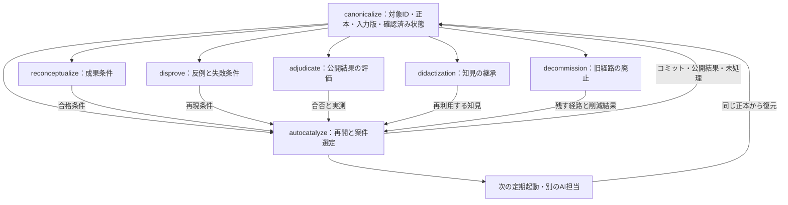

AIエージェントが別の担当に交代したとき、渡すべきものは長い会話履歴ではありません。**何を直したか、どの版を確認したか、何がまだ終わっていないかを、次の担当が同じ意味で読める正本**です。

大量のリポジトリを運用すると、同じ値をWeb・CSV・記事から参照したり、複数のAIが時間差で同じ仕事を引き継いだりします。正本が分裂すると、改善したつもりで古い値を再公開し、確認済みの修正をもう一度実行し、使われている旧経路まで削除する原因になります。

[Kafstyler](https://github.com/KAFKA2306/kafstyler)は、この問題に対して7 Skillsを分けています。そのうち`canonicalize`は、**データ・判断・版・作業状態を同じ正本につなぎ、他の6 Skillsが同じ対象を扱えるようにする基盤**です。`autocatalyze`が仕事を継続し、`canonicalize`が何を引き継ぐかを確定します。

## なぜ「会話を引き継ぐ」だけでは足りないのか

公開サービスの修正には、Gitコミット、元データ、変換コード、公開URL、確認結果が関わります。AI担当が「修正しました」と報告しても、別の担当は次の疑問に答えられません。何の版を確認したのか。公開先にも反映されたのか。同じ入力を再処理してよいのか。古い生成処理はまだ使われているのか。

`canonicalize`は、同じ意味の情報に競合する現行の正本を作らず、対象ID・版・出典・更新経路・処理済み位置を結びます。データの正本は対象リポジトリ、実行結果は既存のIssueや実行履歴など、情報の用途に適した管理先を使います。新しい巨大な台帳を増やすことが目的ではありません。

## 1タップの改修で、出典がずれる条件を試した

実際の改修では、[半導体企業の四半期決算一覧](https://kafka2306.github.io/semiconductor-earnings-model/earnings/)から、その行の数字の出典である米国SECの提出書類へ直接移動できるようにしました。以前は企業の詳細画面へ進み、同じ四半期を探し直す必要がありました。

[改修PR #271](https://github.com/KAFKA2306/semiconductor-earnings-model/pull/271)には、同じ公開APIデータを使った変更前後の比較が残っています。

| 確認対象 | 変更前 | 変更後 |
| --- | --- | --- |
| NVIDIAの2026年7月26日期の行から該当SEC書類へ移動するリンク操作 | 2クリック | 1クリック |
| 四半期データのある11社のうち、一覧から直接出典を開ける会社 | 0社 | 11社 |
| 別の四半期の実在する提出書類URLを紛れ込ませた場合 | 表示している数値との対応が分かりにくい | 改修で追加した照合が失敗する |

NVIDIAの対象期の数値と書類の対応は[SECの提出書類](https://www.sec.gov/Archives/edgar/data/1045810/000104581026000075/0001045810-26-000075-index.html)から確かめられます。PRには、幅390pxのChromiumで実際の公開HTMLを操作し、配信されたコミットを読み戻した記録もあります。[配信後の確認と障害復旧記録](https://github.com/KAFKA2306/semiconductor-earnings-model/pull/271)

この改修の要点は、リンクの数を減らしたことだけではありません。**企業ID・四半期末・指標・数値・出典書類を一組として扱い、見た目が正常な誤リンクを検出できるようにしたこと**です。`canonicalize`が扱う「同じ対象を同じ意味と版で特定する」という設計原則が、ここで役に立ちます。

## canonicalizeは、すべてのSkillが読む事実をそろえる

長期運用の設計では、`canonicalize`は単なるMarkdown整理やデータベース整形ではありません。ほかのSkillsが同じ判断の材料を使えるよう、正本と識別子、変更前後の版、根拠と再開位置をそろえます。

| Skill | `canonicalize`が渡す情報 | Skillが担当する仕事 |
| --- | --- | --- |
| [`autocatalyze`](https://github.com/KAFKA2306/kafstyler/blob/main/skills/autocatalyze/SKILL.md) | 作業ID、対象コミット、最終確認結果、未処理、再開条件 | 案件選定、修正、公開確認、次の起動への引き継ぎ |
| [`reconceptualize`](https://github.com/KAFKA2306/kafstyler/blob/main/skills/reconceptualize/SKILL.md) | 対象の識別子と現行の利用先 | 利用者が最終的に達成すべき操作と合格条件を定める |
| [`disprove`](https://github.com/KAFKA2306/kafstyler/blob/main/skills/disprove/SKILL.md) | 元資料、入力版、訂正履歴 | 数値と出典の不一致、同一データの二重取り込みなどの反例を調べる |
| [`adjudicate`](https://github.com/KAFKA2306/kafstyler/blob/main/skills/adjudicate/SKILL.md) | 変更前後の入力版、単位、比較条件 | 公開結果を同条件で測り、採否を決める |
| [`didactization`](https://github.com/KAFKA2306/kafstyler/blob/main/skills/didactization/SKILL.md) | 原典、検証結果、訂正履歴 | 別プロジェクトでも再利用できる知見を文章にする |
| [`decommission`](https://github.com/KAFKA2306/kafstyler/blob/main/skills/decommission/SKILL.md) | 現行の正本、旧版との対応、切替条件 | 後継の動作を確認し、旧経路・重複処理・不要な監視を廃止する |



たとえば`adjudicate`だけが古いCSVを評価していたら、どれほど厳密に測定しても修正後の品質は分かりません。`decommission`が移行先を取り違えたら、必要な処理まで消してしまいます。各Skillの判断を独立させながら、**判断対象と証拠を統一する**ことに`canonicalize`の重要性があります。

## 常時稼働で失敗しやすいのは「処理済み」の意味

同じ案件でも、**作業ID**、**予定された起動・イベントID**、**再試行ごとの実行ID**は別物です。`canonicalize`はそれらを識別し、外部へ書き込む前後の状態を区別します。

例えば公開リクエストを送った直後に応答が切れた場合、次のAIが直ちに同じ公開処理を繰り返すと重複公開の危険があります。`autocatalyze`はまず公開先を読み戻し、同じ版が届いているかを確かめます。`canonicalize`は最後に確認した処理位置と結果の参照先を保持し、再開判断に使えるようにします。

`decommission`が重要になるのは、その後です。新しい取得・集計・公開経路への移行が成立しても、古い定期ジョブ、通知、互換分岐が残れば、次の起動で二重処理が再発しかねません。`canonicalize`が切替先と必要な履歴を示し、`adjudicate`が後継の成果を確かめ、`decommission`が旧方式を撤去します。

`autocatalyze`が成果を増やすSkillなら、`decommission`はその成果を維持するための負担を減らすSkillです。

## 複数リポジトリへ適用するとき、何を共有するか

[cast_event_cal](https://github.com/KAFKA2306/cast_event_cal)、[know](https://github.com/KAFKA2306/know)、[semiconductor-earnings-model](https://github.com/KAFKA2306/semiconductor-earnings-model)は、イベント情報、知識サイト、企業決算という異なる対象を扱います。三つのデータを一つのファイルへ押し込むのではなく、各リポジトリの正本を保ったまま、案件の識別と成果の引き継ぎ方をそろえます。

例えば、イベントでは開催回IDと告知元、知識サイトでは記事IDと原典・改訂日、企業決算では企業ID・対象期・通貨・単位・提出書類を一貫させます。次の担当AIに渡すのは、対象リポジトリとコミット、前回の検証結果、残作業、次の起動条件です。

`canonicalize`に依頼するときは、次のように対象と判断を指定します。

```text
対象: KAFKA2306/cast_event_cal、KAFKA2306/know、
      KAFKA2306/semiconductor-earnings-model

canonicalizeで各リポジトリの正本、対象ID、版、出典、
更新元と公開先の対応を調べる。
競合する定義・重複した履歴を見つけ、既存の管理先に統一する。
autocatalyzeが再開できるよう、作業ID・対象コミット・
最後に確認した結果・未処理工程・次の起動条件を整理する。
移行先と利用経路が確認できた旧処理をdecommissionに渡し、
adjudicateで公開結果と移行前後を比較する。
```

**AIの引き継ぎは、前任者の説明を信じる作業から、正本を読み直して事実を確かめる作業へ変える。** それが、`canonicalize`を長期運用の基盤に置く理由です。

[設計思想と7 Skillsの最新版](https://github.com/KAFKA2306/kafstyler#readme) · [canonicalizeの手順](https://github.com/KAFKA2306/kafstyler/blob/main/skills/canonicalize/SKILL.md) · [実装・実測の記録](https://github.com/KAFKA2306/semiconductor-earnings-model/pull/271)
